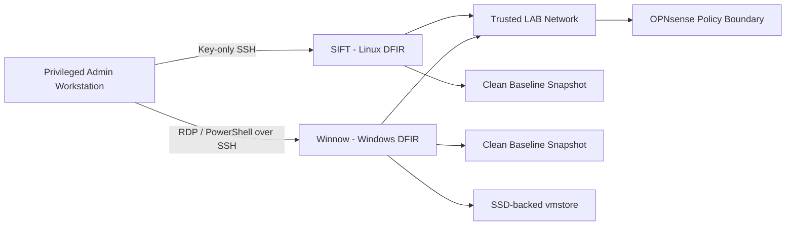
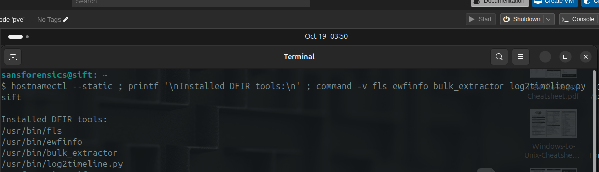
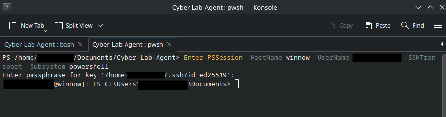
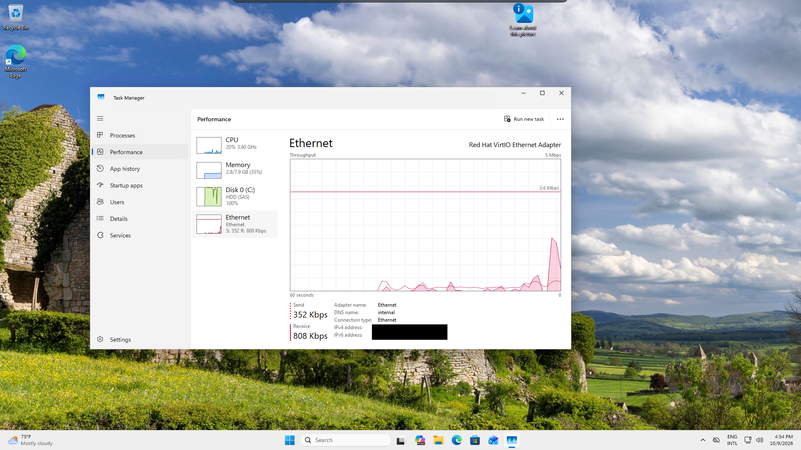
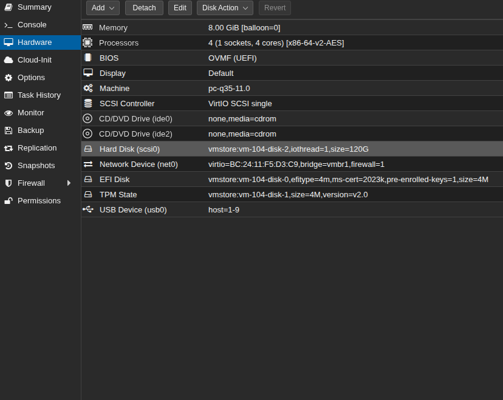

# DFIR Workstation Engineering

## Overview

This project documents the engineering, validation, and remediation of complementary Linux and Windows digital-forensics workstations inside a segmented Proxmox lab.

The goal was not simply to install forensic tools. The environment needed repeatable analyst platforms with clean baselines, controlled management paths, virtualization integration, and enough operational stability to support coursework, investigations, and future lab scenarios.

The resulting design uses:

- **SIFT** as the Linux-focused DFIR workstation;
- **Winnow** as the Windows-focused DFIR workstation;
- a trusted internal lab segment;
- clean snapshots and QEMU guest-agent integration;
- key-based remote administration;
- RDP and PowerShell-over-SSH for Windows management;
- storage-placement decisions validated through observed guest performance.

## At a Glance

- **Hypervisor:** Proxmox VE
- **Linux DFIR workstation:** SIFT
- **Windows DFIR workstation:** Winnow (Windows 11)
- **Network placement:** Trusted LAB
- **Management:** key-based OpenSSH, RDP, PowerShell 7 over SSH
- **Recovery model:** clean baseline snapshots
- **Virtualization integration:** QEMU guest agent
- **Engineering remediation:** Winnow OS disk migrated from HDD-backed QCOW2 storage to SSD-backed `vmstore`
- **Validation:** workstation boot, tool availability, management access, and post-migration performance recovery

## Problem

A useful DFIR lab requires more than one operating system and more than a collection of installed tools.

The analyst workstations needed to provide:

- Linux and Windows investigative environments;
- stable, repeatable baselines;
- controlled remote administration;
- preservation of clean states before coursework or investigation-specific changes;
- enough virtualization integration to simplify lifecycle management;
- storage performance appropriate for forensic workloads.

The Windows workstation eventually exposed an additional engineering problem: sustained 85–100% guest disk active time despite relatively low memory consumption.

## Architecture

Both DFIR systems reside in the Trusted LAB rather than the offensive/range segment. This preserves a cleaner analyst environment for evidence handling and coursework while keeping management traffic explicit and controlled.

## Linux DFIR Workstation — SIFT

SIFT provides the Linux-centric analysis environment.

The baseline includes:

- clean snapshot state;
- QEMU guest-agent integration;
- trusted-lab placement;
- key-based remote administration;
- operational forensic tooling.

Representative DFIR tools validated on the host include:

- `fls`
- `ewfinfo`
- `bulk_extractor`
- `log2timeline.py`

### Evidence

*Figure 1. Operational SIFT workstation with representative forensic tools available from the shell.*

## Windows DFIR Workstation — Winnow

Winnow provides the Windows-focused analysis environment.

The workstation was configured with:

- Windows 11;
- clean baseline snapshot;
- QEMU guest-agent integration;
- RDP for interactive administration;
- OpenSSH Server using key-based authentication;
- PowerShell 7 remoting over the SSH `powershell` subsystem.

This creates a Windows analysis platform that can be administered remotely without enabling password-based SSH authentication or depending on WinRM for the standard PowerShell management path.

### Secure Management Evidence

*Figure 2. Successful PowerShell 7 remoting to the Windows DFIR workstation over the SSH subsystem. User-identifying details were redacted for publication.*

## Storage Performance Remediation

### Symptom

During normal operation, Winnow showed sustained 85–100% virtual-disk active time while memory utilization remained comparatively low.

The symptom was visible inside the guest and was severe enough to affect responsiveness.

*Figure 3. Pre-remediation symptom: the Windows guest reports 100% active time on the system disk while memory usage remains comparatively moderate.*

### Investigation

The investigation compared guest behavior with the VM's Proxmox storage configuration.

The OS disk was found to be a QCOW2 image located on bulk HDD-backed storage rather than on the lab's SSD-backed VM storage.

That finding provided a plausible storage-latency explanation for the high guest disk-active-time symptom.

### Remediation

The Winnow OS disk was migrated to SSD-backed `vmstore`.

After migration:

- the VM booted normally;
- normal management access remained functional;
- guest disk activity and responsiveness returned to normal;
- a fresh post-migration snapshot was created;
- the obsolete pre-migration snapshot was removed;
- the old bulk-storage source disk was deleted after validation.

*Figure 4. Current Winnow storage placement after migration to SSD-backed `vmstore`.*

## Validation

| Test | Expected Result | Result |
|---|---|---|
| SIFT boots from clean baseline | Operational | Pass |
| Representative SIFT forensic tools callable | Available | Pass |
| Winnow boots after storage migration | Operational | Pass |
| QEMU guest integration | Functional | Pass |
| Key-based SSH management | Allowed | Pass |
| Winnow RDP management | Allowed | Pass |
| PowerShell 7 over SSH | Allowed | Pass |
| Post-migration Windows responsiveness | Normalized | Pass |
| Clean post-migration Winnow snapshot | Created | Pass |

## Engineering Lessons

### Tool installation is not the same as workstation engineering

A forensic workstation has to be maintained as an operational platform. That includes lifecycle management, recoverability, storage placement, access control, and validation after changes.

### Guest symptoms must be correlated with hypervisor state

The Winnow issue could have been misdiagnosed as a generic Windows performance problem. Looking at both the guest and the virtualization layer exposed the actual storage-placement issue.

### Baselines matter

Clean snapshots allow each workstation to return to a known-good state before coursework, investigations, or tool changes.

### Remote management should remain constrained

The administration path is built around key-based SSH, RDP where appropriate, and PowerShell-over-SSH rather than broad management exposure.

## Outcome

The lab now has complementary Linux and Windows DFIR workstations with repeatable baselines, controlled administration, and validated operational behavior.

The project demonstrates:

- Proxmox VM engineering;
- DFIR workstation design;
- Linux and Windows forensic-tool environments;
- OpenSSH and PowerShell remoting;
- RDP administration;
- QEMU guest integration;
- snapshot and baseline management;
- guest/hypervisor troubleshooting;
- storage-performance analysis;
- HDD-to-SSD VM storage migration and post-change validation.

## Current Boundaries

This project documents workstation engineering and readiness, not a claim that every available forensic tool has been individually validated.

FLARE VM and Security Onion are separate future lab capabilities and are not represented here as completed components.

## Technologies

Proxmox VE · SIFT · Windows 11 · OpenSSH · PowerShell 7 · RDP · QEMU Guest Agent · QCOW2 · VirtIO SCSI · LVM-Thin · SSD Storage · Digital Forensics

## Portfolio Summary

Engineered complementary Linux and Windows DFIR workstations in a segmented Proxmox lab with clean snapshots, QEMU guest integration, secure remote administration, and role-specific forensic tooling. Diagnosed sustained Windows disk saturation by correlating guest performance with hypervisor storage placement, migrated the OS disk from HDD-backed QCOW2 storage to SSD-backed `vmstore`, and validated normal operation after remediation.
